 

 

## 👋 About Me

I'm a fresh **Informatics Engineering graduate** from **Institut Teknologi Padang** (GPA 3.68/4.00), based in Padang, Indonesia. I build full-stack web applications, from database design and REST APIs to the user interface, and I enjoy turning real business needs into reliable systems.

- 📊 **Final project:** a sales forecasting system using the Holt-Winters method, with an average MAPE below 20% on real company data
- 💼 **Internship experience** as a full-stack programmer at Mediatama Web Indonesia
- 🌱 **Always learning** new technologies and improving how I write and structure code
- 🚀 **Open to** entry-level software developer opportunities

 

## 🛠️ Tech Stack

<table>
  <tr>
    <td width="200"><b>🎨 Frontend</b></td>
    <td>
      
      
      
      
      
    </td>
  </tr>
  <tr>
    <td><b>⚙️ Backend</b></td>
    <td>
      
      
      
      
    </td>
  </tr>
  <tr>
    <td><b>🗄️ Database</b></td>
    <td>
      
      
    </td>
  </tr>
  <tr>
    <td><b>🧰 Tools & Other</b></td>
    <td>
      
      
      
      
    </td>
  </tr>
</table>

 

## 🚀 Featured Projects

<table>
  <tr>
    <td width="50%" valign="top">
      <h3>📈 Coffee Bean Sales Forecasting</h3>
      
Forecasts sales and stock needs for a coffee company in Kerinci using Holt-Winters. Hybrid architecture with Admin and Manager roles.

      

        
        
        
        
      

      
<a href="https://github.com/DoriFransDika/Sistem-Peramalan-Penjualan-Menggunakan-Holt-Winters"><b>View repository →</b></a>

    </td>
    <td width="50%" valign="top">
      <h3>🧾 SME Business & Inventory System</h3>
      
Client project for monitoring stock, cash flow, automatic profit and loss, and a selling-price calculator.

      

        
        
      

      
<a href="dapur-mamak.vercel.app"><b>Live demo</b></a> · <a href="https://github.com/DoriFransDika/Management-Bisnis"><b>Repository →</b></a>

    </td>
  </tr>
  <tr>
    <td width="50%" valign="top">
      <h3>🎓 Tutoring Management System</h3>
      
Team internship project built from scratch with role-based access for Admin, Member, and Mentor, plus a monitoring panel.

      

        
        
        
      

      
<a href="https://github.com/DoriFransDika/Sistem_management_bimbingan_digital"><b>View repository →</b></a>

    </td>
    <td width="50%" valign="top">
      <h3>🪪 Automated Card Printing System</h3>
      
Bulk card creation from a standard design template, producing print-ready cards in under 3 minutes.

      

        
      

      
<a href="mesin-pencetak-kartu.vercel.app"><b>Live demo</b></a> · <a href="https://github.com/DoriFransDika/mesin-pencetak-kartu"><b>Repository →</b></a>

    </td>
  </tr>
</table>

 

## 📊 GitHub Stats

  
  

 

  

